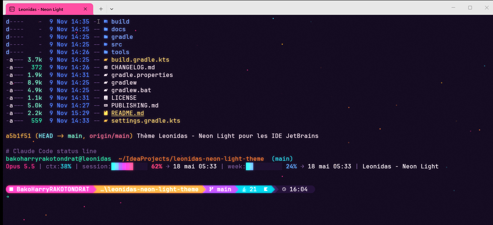

# Leonidas - Neon Light · Terminal

[](https://github.com/Harrylepap/leonidas-neon-light-terminal/actions/workflows/ci.yml)

A neon-soaked terminal style for Windows, inspired by neon-lit Miami nights: deep purple skies, hot pink signs, sunset orange, lagoon turquoise and golden yellow.

Companion of the [Leonidas - Neon Light theme for JetBrains IDEs](https://github.com/Harrylepap/leonidas-neon-light-theme).



## What's inside

| Component | File | What it does |
|---|---|---|
| **Windows Terminal color scheme** | `windows-terminal/leonidas-neon-light.scheme.json` | Purple night background, neon ANSI palette, **golden yellow selection** |
| **Neon shader** | `windows-terminal/leonidas-neon.hlsl` | Soft neon glow around colored text + twinkling sparkles drifting up the background (never over text). Toggle with <kbd>Ctrl</kbd>+<kbd>Alt</kbd>+<kbd>G</kbd> |
| **Starship prompt** | `starship/starship.toml` | Powerline prompt in a hot pink → sunset → violet → lagoon gradient: OS, user, directory, git branch/status, project language versions, time |
| **eza (ls replacement)** | `bash/leonidas-neon.bash` | `ls` / `ll` / `la` / `lt` aliases with Nerd Font icons, directories first and git status, colored by the neon palette; also puts winget-installed eza and Starship on the Git Bash PATH |
| **Claude Code status line** | `claude-code/statusline.ps1` | Two-line status line: user, directory, git branch, model, context usage, and rate-limit gauges drawn as a lagoon → violet → pink → orange → gold gradient |

## Palette

| Role | Color |
|---|---|
| Background | `#12091F` |
| Hot pink | `#FF2E88` / `#FF4FA3` |
| Sunset orange | `#FF7A2F` |
| Golden yellow (selection) | `#FCAF17` |
| Mint | `#2EE6A6` |
| Lagoon | `#2BD9E8` |
| Violet | `#8E3FD6` / `#C04DFF` |

## Requirements

- Windows 10/11 with [Windows Terminal](https://aka.ms/terminal)
- A [Nerd Font](https://www.nerdfonts.com/) set as the terminal font (e.g. *JetBrainsMono Nerd Font*), needed by the prompt icons
- [Starship](https://starship.rs/) and [eza](https://eza.rocks/): `winget install Starship.Starship eza-community.eza`, or run the installer with `-InstallTools`
- Optional: [Claude Code](https://claude.com/claude-code) for the status line

## Install

```powershell
git clone https://github.com/Harrylepap/leonidas-neon-light-terminal.git
cd leonidas-neon-light-terminal
powershell -ExecutionPolicy Bypass -File .\install.ps1
```

Every file the script modifies is backed up first (`<file>.bak-<timestamp>`). It:

1. adds the color scheme to Windows Terminal and applies it to **all profiles** (opacity 92 %, acrylic, bar cursor, pink tab), enables the shader and binds <kbd>Ctrl</kbd>+<kbd>Alt</kbd>+<kbd>G</kbd>;
2. installs `~/.config/starship.toml` and `~/.config/leonidas-neon-light/leonidas-neon.bash` (eza aliases + starship init), sourced from `~/.bashrc` (Git Bash);
3. installs the Claude Code status line in `~/.claude/` and sets `statusLine` in `~/.claude/settings.json`.

Options:

| Option | Effect |
|---|---|
| `-InstallTools` | Install Starship, eza and JetBrainsMono Nerd Font with winget first |
| `-NoShader` | Color scheme only, no glow / sparkles |
| `-SkipWindowsTerminal` | Leave Windows Terminal untouched |
| `-SkipStarship` | Leave the prompt untouched |
| `-SkipClaudeCode` | Leave Claude Code untouched |

For PowerShell, add `Invoke-Expression (&starship init powershell)` to your `$PROFILE` to get the same prompt.

## Manual install

- **Windows Terminal**: open *Settings > Open JSON file*, paste the content of `leonidas-neon-light.scheme.json` into `"schemes"`, then set `"colorScheme": "Leonidas - Neon Light"` in `profiles.defaults`. For the shader, add `"experimental.pixelShaderPath": "C:\\path\\to\\leonidas-neon.hlsl"`.
- **Starship**: copy `starship/starship.toml` to `~/.config/starship.toml` and `starship/build-target.sh` to `~/.config/starship/`.
- **Git Bash (eza + starship)**: copy `bash/leonidas-neon.bash` somewhere and add `. /path/to/leonidas-neon.bash` to `~/.bashrc`.
- **Claude Code**: copy `claude-code/statusline.ps1` anywhere and set in `~/.claude/settings.json`:
  ```json
  "statusLine": { "type": "command", "command": "powershell.exe -NoProfile -ExecutionPolicy Bypass -File C:/path/to/statusline.ps1" }
  ```

## Tweaking

- **Shader**: the constants at the top of `leonidas-neon.hlsl` (`GLOW_STRENGTH`, `SPARK_DENSITY`, `SPARK_STRENGTH`, `SPARK_CELL`) control the glow and the amount of sparkles. Windows Terminal reloads the shader when the file changes.
- **Prompt**: colors live in the `[palettes.leonidas_neon]` section of `starship.toml`.
- **Status line**: the `$NEON` table maps ANSI codes to the neon truecolors; date labels are in French.

## Uninstall

Restore the `.bak-<timestamp>` files created by the installer, or pick another color scheme in Windows Terminal settings.

## Tests

```powershell
python tests/validate.py          # static checks
Invoke-Pester tests               # installer + status line (Pester 5)
```

CI also renders the Starship prompt, compiles the shader with `fxc` and runs PSScriptAnalyzer.

## License

[MIT](LICENSE)
